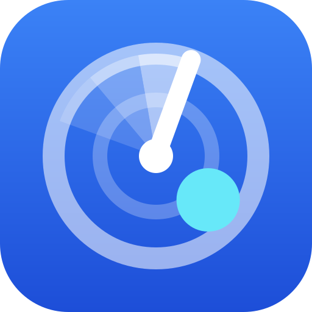

# Radar CNPJ — skill and MCP server for AI agents



Radar CNPJ gives your agent a Brazilian company's registration status, public sanctions and federal tax debt
in one free response. The records are already joined by CNPJ, with source dates.
Use the result without collecting and combining each source.
This repository supplies the skill and remote MCP connection for your agent.

**Site:** https://radar-cnpj.com · **MCP server:** `https://radar-cnpj.com/mcp?checkout=site` · **Prices:** https://radar-cnpj.com/pricing ·
**API docs:** https://radar-cnpj.com/developers

## What your agent can do

- Look up a company by CNPJ: status, activities (CNAE), address, partners, sanctions (CEIS, CNEP, CEPIM, TCU and
  CNIA), federal tax debt and contracts with the government.
- Search companies by name, trade name, partner, phone, address or activity, in a state or a city.
- Check a list of suppliers or customers in one call.
- Evaluate a business idea: count the active, opened and closed companies of an activity in a place.
- Monitor a CNPJ and read its changes.

For a basic check, use `get_cnpj` with `temas: "dados,sancoes,divida"`.
Read `data.situacao.label`, `data.sancoes.vigentes` and `data.dividaAtiva.inscricoes`.
Use `health` for the registry snapshot date. Each linked source keeps its own date.

Buy only the addition the task needs: a required CNIA source check, a formatted supplier report,
available details without a mask, a risk dossier or continued monitoring.
For a required CNIA check, set `cnia_atual: true` on `consulta_cnpj` or `dossier_cnpj`.
Source failure returns 503 without charging or using an older CNIA.
Without this requirement, inspect the returned CNIA date.
The batch preserves source dates, evidence and truncation flags.
It uses stored CNIA by default. A required source check uses `cnia_atual: true`
for at most four distinct numeric CNPJs per group, with refusal without charging if the source fails.
Check the quote, existing access and expiry before paying.
Paying does not refresh all source snapshots or issue an official certificate.
An existing registry API can be enough for status alone.

Try: *"Check CNPJ 33.000.167/0001-01 for sanctions and federal tax debt."* or
*"How many bakeries are active in Águas Claras, DF?"*

## Install

Claude Code, as a plugin with the skill and the MCP server:

```
/plugin marketplace add wrpbr/radar-cnpj
/plugin install radar-cnpj@radar-cnpj
```

Any agent that reads Agent Skills (Claude Code, Codex, Cursor, OpenCode and others):

```bash
npx skills add wrpbr/radar-cnpj
```

Only the MCP server (remote, Streamable HTTP, no key for the free tools):

```bash
claude mcp add --transport http radar-cnpj 'https://radar-cnpj.com/mcp?checkout=site'   # Claude Code
codex mcp add radar-cnpj --url 'https://radar-cnpj.com/mcp?checkout=site'               # Codex
```

```json
{ "mcpServers": { "radar-cnpj": { "url": "https://radar-cnpj.com/mcp?checkout=site" } } }
```

The JSON above goes in `.cursor/mcp.json` for Cursor and in the MCP settings of most other clients. In Claude.ai and
Claude Desktop, open Settings → Connectors → Add custom connector and paste the server address.

## Price

The public CNPJ record and search need no key. The additional company check has its own free allowance.
The company dossier and extra monitoring use paid access. Read `/api/pricing` for current allowances and prices.
You buy plans and prepaid credit on the site. With `checkout=site`, the MCP server has no purchase tool or x402 payment
argument. The agent shows the price and the link, and after your purchase it uses your credit token. The current
prices are at https://radar-cnpj.com/pricing.

For an agent authorized to pay, the direct `/mcp` also exposes existing per-call services without an account.
Read `/api/pricing` and `/api/billing` first. An x402 quote is in `structuredContent`;
retry with `params._meta["x402/payment"]` only within the user's budget.
The site offers Pix or card only when that method is enabled.

## What the plugin sends

The skill tells the agent to call the Radar CNPJ API at radar-cnpj.com. The MCP server also runs at radar-cnpj.com.
Your queries (CNPJ numbers, search terms and places) go to radar-cnpj.com over HTTPS. A credit token goes only when
you give one for a paid call. The plugin runs no local program and reads no local file.

## Data and limits

The data comes from the public CNPJ dump of Receita Federal and from the public databases that each answer names,
with their dates. Radar CNPJ is not an official certificate. Partner names, phones and e-mails are masked by
default. Use personal data only for a legitimate purpose, as the Brazilian data protection law (LGPD) requires.

## Em português

O Radar CNPJ reúne situação cadastral, sanções públicas e dívida da União em uma resposta gratuita,
com fontes e datas. O cruzamento pelo CNPJ já está pronto.
Este repositório traz a skill e a conexão com o servidor MCP remoto. Instale com os comandos acima. A consulta de
CNPJ pública e a busca não pedem chave. A consulta adicional tem franquia própria.
Neste plugin, a pessoa compra no site; o agente usa o crédito que ela fornecer.
O MCP direto também oferece chamadas pagas por x402, com autorização e orçamento.
Compre só o acréscimo que falta à tarefa. CNIA exigido durante o pedido usa `cnia_atual: true`:
se a fonte falhar, a consulta ou o dossiê recusam sem cobrar nem usar o registro anterior.
Os preços estão em https://radar-cnpj.com/pricing.

## Files

| File | What it is |
|---|---|
| `skills/radar-cnpj/SKILL.md` | The skill: which tool answers which question, and the rules for paid calls and personal data |
| `.mcp.json` | The remote MCP server of the plugin |
| `.claude-plugin/plugin.json` | The plugin manifest |
| `.claude-plugin/marketplace.json` | Lets Claude Code add this repository as a plugin marketplace |
| `server.json` | The manifest in the official MCP registry (`com.radar-cnpj/radar-cnpj`) |
| `glama.json` | The maintainer for the Glama MCP directory |

## License and contact

The files in this repository are under the MIT-0 license. The Radar CNPJ service and its data are not part of this
license: their use follows the [terms of use](https://radar-cnpj.com/termos) and the
[privacy policy](https://radar-cnpj.com/privacidade). For questions or problems, open an issue here or write to
contato@radar-cnpj.com.
